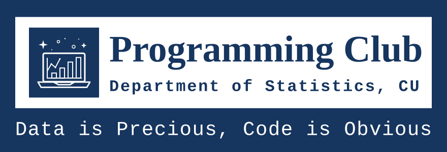

# Statistics Programming Club Website

<div style="height: 100%; overflow: hidden;">
  
</div>
<br>

> Official website for the **Programming Club**, Department of Statistics, University of Chittagong.

---

## 👥 Repo Maintainers

Hi, I'm **Naim [2021-22]**, the creator of this website. If you ever have the opportunity to maintain this repo, drop your name below.

| Name | Role | Year | Email
|---|---|---|---|
| **Muhammad N. Naim** | **Creator** | **2026** |   |

---

## 📁 Project Structure

This is a **Next.js 16** application using **React 19** and **TypeScript**.

```
.
├── src/
│   ├── app/             # Next.js App Router (Pages & API)
│   │   ├── layout.tsx   # Root layout & Theme provider
│   │   ├── page.tsx     # Home page
│   │   ├── profile/     # Portfolio page (uses query param: ?id=<student_id>)
│   │   ├── cv/          # Executive CV page (uses query param: ?id=<student_id>)
│   │   ├── admin/       # Unified admin panel
│   │   └── api/         # Next.js API endpoints (e.g. save-data)
│   ├── components/      # Shared React components
│   ├── context/         # React Context (e.g., ThemeContext)
│   └── lib/             # Utilities & Data fetching logic
├── public/              # Static assets & JSON data
│   └── resources/       # ⭐ All database files and images live here
│       └── data/        # JSON database files
├── docs/                # Project documentation
└── package.json         # Project dependencies & scripts
```

> **The golden rule:** Content is decoupled from code. Data lives in JSON files within `public/resources/data/`. To update site content, edit these JSON files or use the provided unified Admin Panel.

### Portfolio & CV System

The portfolio and CV system allows each executive to have a dedicated profile and resume page.

- **Portfolio Page**: `/profile?id=<student_id>` (`src/app/profile/page.tsx`) — Displays executive profile, projects, and achievements. Opt-in Dynamic Profiles (`DynamicProfile.tsx`) render a magazine-style view if `profile_link` is defined in `executives.json`.
- **CV Page**: `/cv?id=<student_id>` (`src/app/cv/page.tsx`) — Displays a professionally formatted resume based on a custom JSON file.
- **Alumni Section**: `/alumni` (`src/app/alumni/AlumniList.tsx`) — Displays past executives with links to their portfolios.

---

## 🚀 Running the Site Locally

Since this is a Next.js app, you need **Node.js** installed.

### 1. Install dependencies
```bash
npm install
```

### 2. Start development server
```bash
npm run dev
```
Then open [http://localhost:3000](http://localhost:3000) in your browser.

### 3. Build for production
```bash
npm run build
npm run start
```

---

## 🗄️ Understanding the JSON Files

All data files live inside `public/resources/data/`. These files are read server-side via `src/lib/data.ts` and client-side via `src/lib/clientData.ts`.

---

### `public/resources/data/executives.json`

```json
{
  "current_committee": "2026-27",

  "committees": [
    {
      "session":       "2026-27",
      "label":         "2026 – 2027",
      "total_members": 8,
      "members": [ ... ]
    }
  ]
}
```

| Field | Type | Description |
|---|---|---|
| `current_committee` | `string` | Must exactly match a `session` value. Determines which committee is **Current Executives** and which are **Past Executives**. |
| `committees` | `array` | All committees, newest first. |
| `session` | `string` | Unique ID — no spaces (e.g. `"2026-27"`). |
| `label` | `string` | Display label shown on the website (e.g. `"2026 – 2027"`). |
| `total_members` | `number` | **Optional.** Total member count used in the home page stats. If omitted, the site counts the `members` array length automatically. |
| `members` | `array` | List of member objects (see below). |

#### Member Object

```json
{
  "student_id":   "22774444",
  "initial":      "N",
  "role":         "Join Secretary",
  "role_display": "// JOIN SECRETARY",
  "name":         "Muhammad N. Naim",
  "session":      "2021-22",
  "highlight":    false,
  "bio":          "I build intelligent systems.",
  "socials": [
    { "type": "linkedin",   "label": "LinkedIn",     "url": "https://linkedin.com/in/naim" },
    { "type": "github",     "label": "GitHub",       "url": "https://github.com/naim" },
    { "type": "facebook",   "label": "Facebook",     "url": "https://facebook.com/naim" },
    { "type": "email",      "label": "Email",        "url": "mailto:name@example.com" }
  ],
  "icon_link": "https://example.com/photo.jpg",
  "cv_link": "/cv"
}
```

| Field | Description |
|---|---|
| `student_id` | Unique identifier used for linking to projects and achievements. Must be unique across **all** committees. |
| `initial` | Single letter shown in the avatar card. |
| `role` | Short role name shown on alumni compact cards (e.g. `"Vice President"`). |
| `role_display` | Role shown on the full executive card with `//` prefix (e.g. `"// VICE PRESIDENT"`). |
| `highlight` | `true` gives this member the wide featured card. Only one per committee should be `true`. |
| `bio` | 1–3 sentence bio shown in the profile popup modal. |
| `socials` | Array of social link objects. Supported `type` values: `linkedin`, `github`, `facebook`, `email`, `codeforces`, `twitter`, `instagram`, `website`. |
| `icon_link` | **Optional.** URL to member's photo for the portfolio. Fallback is the avatar initial. |
| `profile_link` | **Optional.** Path to local Profile JSON (e.g., `resources/data/profile_elon.json`) or external Profile JSON URL to opt into the Dynamic Profile magazine layout. |
| `cv_link` | **Optional.** Path to local CV JSON (e.g., `/cv2`) or external CV URL. |

---

### `public/resources/data/achievements.json`

```json
{
  "tally": [
    { "value": "12", "label": "Gold"   },
    { "value": "8",  "label": "Silver" }
  ],
  "achievements": [
    {
      "title":      "1st Place — National Statistics Olympiad",
      "event":      "Bangladesh National Statistics Olympiad",
      "category":   "Olympiad",
      "year":       "2024",
      "tier":       "gold",
      "team_label": "Team",
      "members":    ["22774444", "2020001"]
    }
  ]
}
```

| Field | Description |
|---|---|
| `tally` | Array of `{ value, label }` objects displayed in the tally strip. |
| `tier` | Controls card accent colour. Supported: `gold`, `silver`, `bronze`, `special`, `community`. |
| `category` | Short label shown on the card (e.g. `"Hackathon"`, `"Research"`). |
| `team_label` | Prefix before the members list (e.g. `"Team"`, `"Project"`, `"Member"`, `"Authors"`). |
| `members` | Array of student IDs of the club members associated with the achievement. |

---

### `public/resources/data/events.json`

```json
{
  "note": "Events are posted to our Facebook group 1 week in advance.",
  "events": [
    {
      "id":            "ev-001",
      "title":         "Python for Data Analysis — Workshop",
      "date":          "2025-05-12",
      "time":          "2:00 PM",
      "location":      "Room 406, Science Faculty Building",
      "audience":      "All levels welcome",
      "type":          "workshop",
      "register_link": "https://forms.google.com/...",
      "details_link":  "https://facebook.com/events/..."
    }
  ]
}
```

| Field | Description |
|---|---|
| `date` | ISO format `YYYY-MM-DD`. Events are **automatically sorted by date ascending** — nearest first. |
| `type` | Controls the tag colour. Supported: `upcoming`, `workshop`, `contest`, `seminar`, `other`. |
| `register_link` | **Optional.** If provided, a green **Register** button appears on the event row. |
| `details_link` | **Optional.** If provided, a blue **View Details** button appears — link this to your Facebook or LinkedIn event page. |
| `note` | Footer text shown below the events list. |

---

### `public/resources/data/projects.json`

```json
{
  "projects": [
    {
      "title": "Club Website",
      "description": "This very website — an open-source, data-driven Next.js site for the Statistics Programming Club. All content is managed through JSON files with a custom visual editor.",
      "status": "active",
      "tags": ["Next.js", "React", "TypeScript", "CSS", "JSON"],
      "members": ["22774444"],
      "year": "2026",
      "link": "https://github.com/",
      "demo_link": "/",
      "featured": true
    }
  ]
}
```

| Field | Description |
|---|---|
| `status` | Controls the status badge. Supported: `active`, `completed`, `research`, `publication`. |
| `tags` | Array of technology/language tags shown as chips on the card. |
| `members` | Array of student IDs linking members to the project. |
| `link` | **Optional.** Repo URL — shown as a green **Repo ↗** button. |
| `demo_link` | **Optional.** Live demo, web interface, or DOI link — shown as a purple **Demo ↗** button. |
| `featured` | **Optional.** If `true`, the project card gets highlighted or positioned at the top. |

---

## 🛠️ Unified Admin Panel (`/admin`)

The website includes an integrated, GUI-based Admin Panel located at `/admin` (`src/app/admin/page.tsx`). It allows authorized maintainers to manage all site content.

| Resource | JSON File | Description |
|---|---|---|
| Executives | `executives.json` | Manages committee members, sessions, and social links. |
| Projects | `projects.json` | Manages club projects and publications. |
| Events | `events.json` | Schedules and manages club activities. |
| Courses | `courses.json` | Manages syllabus and certificate registries. |
| Achievements | `achievements.json` | Manages contest success tallies and entries. |

> ⚠️ **Direct File Saving:** In development mode (`NODE_ENV === 'development'`), clicking the **Save** button in the Admin Panel writes updates directly to the project's data files using the Next.js API route `/api/save-data`. In production/deployed versions, saving directly is disabled; you can export the updated JSON files, copy them manually to `public/resources/data/`, and commit/push.

---

## 📅 How to Transition to a New Academic Year

### Step 1 — Open the Admin Panel
Go to `http://localhost:3000/admin` and select the **Executives** editor from the sidebar.

### Step 2 — Add a new committee
Click **+ Add Committee** and fill in:
- **Session ID:** `2027-28` *(no spaces, hyphens only)*
- **Display Label:** `2027 – 2028`

### Step 3 — Add new executives
Expand the new committee block → click **+ Add Member** for each person. Fill in their details.

### Step 4 — Set total_members
Fill in the **Total Members** field with the actual headcount.

### Step 5 — Set it as the active committee
In the **Active Committee** dropdown, select `2027-28`. The old committee moves to Past Executives automatically.

### Step 6 — Save and commit
Click the **Save** button in the Admin Panel to write changes directly to the filesystem (if in local development mode). Alternatively, click **Export**, replace the file in your repo, and commit:
```bash
git add public/resources/data/executives.json
git commit -m "chore: update to 2027-28 committee [by <your name>]"
git push
```

---

## 🌐 Maintenance of GitHub repo

**After updating data files:**
```bash
git add public/resources/
git commit -m "update: [LATEST CHANGE] [by <your name>]"
git push
```

**After updating static pages or layout:**
```bash
git add src/app/
git commit -m "update: [LATEST CHANGE] [by <your name>]"
git push
```

**After updating styles or global logic:**
```bash
git add src/app/globals.css src/lib/
```
Wait, the styles are in `src/app/globals.css` and the code in `src/lib/`. Commit them:
```bash
git commit -m "update: [LATEST CHANGE] [by <your name>]"
git push
```

GitHub Pages/Vercel redeploys automatically within a minute or two.

---

## 📄 Pages Overview

| Page | Route | Content source |
|---|---|---|
| Home | `/` | Server-side rendered components |
| Current Executives | `/exec` | `executives.json` → `current_committee` |
| Past Executives | `/alumni` | `executives.json` → `all non-current committees` |
| Projects | `/projects` | `projects.json` → `projects[]` |
| Achievements | `/achievements` | `achievements.json` → `tally[]` + `achievements[]` |
| Events | `/events` | `events.json` → upcoming events only, sorted by date |
| About / Contact | `/about` | Static content in `src/app/about/page.tsx` |
| Portfolio | `/profile?id=...` | `executives.json` + `projects.json` + `achievements.json` (or dynamic self-contained JSON if `profile_link` is configured) |
| CV | `/cv?id=...` | Custom CV JSON file linked via member's `cv_link` |

---

## 🛠️ Technical Implementation

The website is built as a high-performance Next.js application.

### 🚀 Routing & Navigation
Using the **Next.js App Router**, the site provides native server-side rendering (SSR) and optimized routing.

### 🌓 Theme System
A dynamic light/dark mode is implemented using a **React Context provider** (`ThemeContext.tsx`) and CSS variables.
- **Persistence:** The selected theme is stored in `localStorage`.
- **Flash Prevention:** An inline script in `layout.tsx` applies the theme before React hydration to prevent visual flashes.

### ✨ Visual Effects & Animations
- **Terminal Typing:** The home page uses a simulated terminal component that types out content character-by-character.
- **Responsive Design:** The site uses a modern responsive layout that adapts to various screen sizes using Tailwind-like CSS variables and standard media queries.

### 🔤 Typography & Icons
The site uses **locally hosted Nerd Fonts** to ensure consistent rendering of "coding" aesthetic icons across all devices.

---

### Changing the accent color
Open `src/app/globals.css` and update the `--ac` variable:
```css
:root {
  --ac: #00d97e;  /* replace with your preferred color */
}
```

### Adding a new page
1. Create a new folder in `src/app/` (e.g., `src/app/new-page/`).
2. Add a `page.tsx` file in that folder.
3. The Next.js App Router handles the routing automatically.

### Adding a new event type
In `src/lib/data.ts`, update the `ClubEvent` interface and the `type` field. Then update the rendering logic in `src/app/events/EventsList.tsx`.

### Adding a new project status
In `src/lib/data.ts`, update the `Project` interface and the `status` field. Then update the rendering logic in `src/app/projects/ProjectSection.tsx`.

---

*Important: Now read docs/CLAUDE.md*
