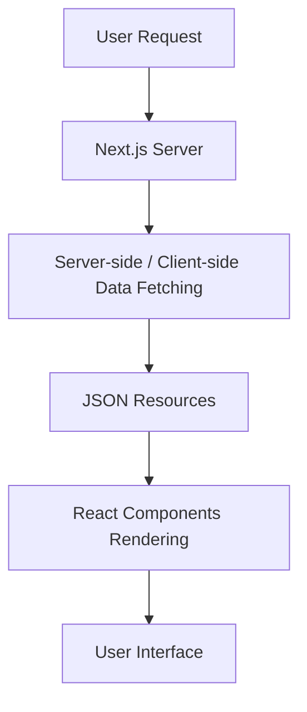
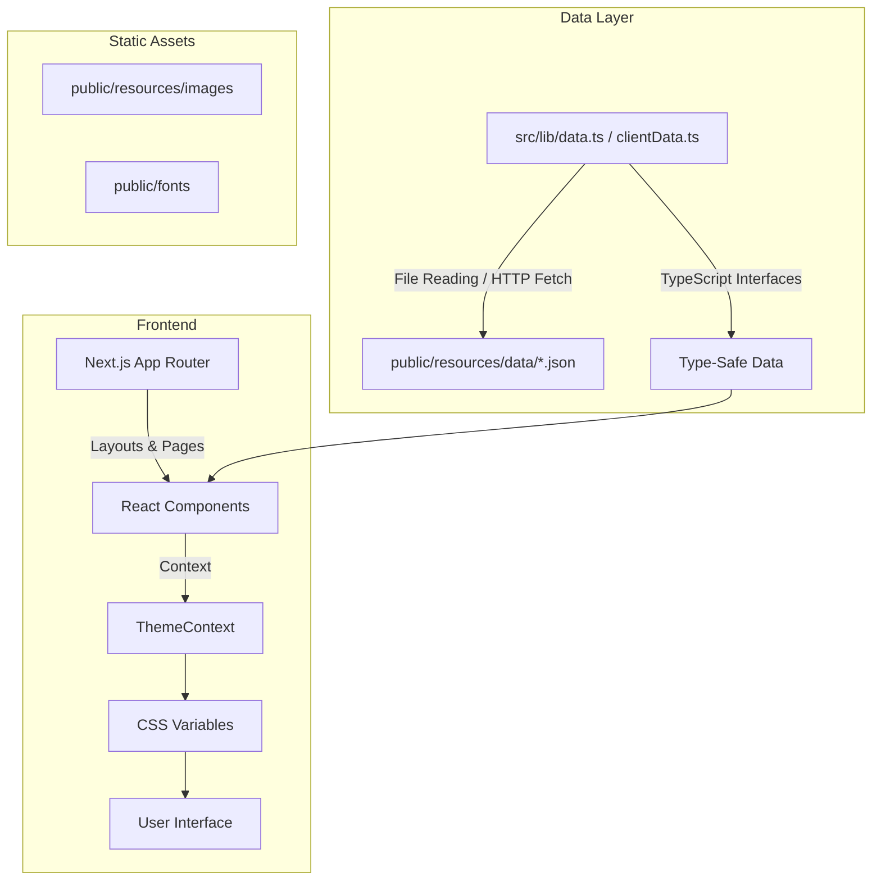

# Architecture Overview

This document describes the architecture of the Statistics Programming Club website, focusing on the transition to a modern **Next.js** framework to improve performance, type safety, and developer experience.

## System Components

### High-Level Flow

### Detailed Component Diagram

## Data-Driven Architecture

The website employs a **Content-as-Data** pattern. Instead of hardcoding content into pages, the site reads from JSON files stored in the `public/` directory.

### Data Management (`src/lib/data.ts` and `src/lib/clientData.ts`)
A centralized utility for loading data:
- **Strong Typing**: All JSON structures are mapped to TypeScript interfaces (e.g., `Member`, `Project`, `ClubEvent`), ensuring that components receive predictable data.
- **Universal Loader**: Fetches JSON from either the local filesystem (`public/resources/`) on the server or via standard client fetches.
- **Server/Client Fetching**: Server components load data directly from the filesystem using `fs/promises` during initial page loads, while client components load data asynchronously using standard `fetch`.
- **Registry-Based Resolution**: Data paths are resolved using the `database.json` registry file to fetch the correct paths dynamically.

### Data Schema (`public/resources/data/*.json`)

- **`executives.json`**: Stores executive committee history and member profiles.
  - **Member**: Contains member details such as name, role, session, bio, social links, `student_id` (used for linking to projects and achievements), and `icon_link` (optional URL to member photo for portfolio display).
  - **Committee**: Contains a list of members for each committee session.
- **`achievements.json`**: Tracks club awards and overall tallies.
- **`events.json`**: Maintains a list of upcoming events.
- **`projects.json`**: Catalogs club projects and publications.
  - **Project**: Contains project details such as title, description, status, tags, members (array of student IDs), year, link, demo link, and featured status.
- **`certificates.json`**: Manages issued certificates.

## Frontend Architecture

### Next.js App Router

The site uses the Next.js App Router for optimized routing and rendering:

- **Server Components**: By default, initial page layouts and statically exportable contents are rendered as Server Components.
- **Client Components**: Interactive elements (like the Theme toggle, Terminal typing effect, and query-based portfolio/CV details) are marked with `'use client'`.
- **Layouts**: `src/app/layout.tsx` provides a consistent shell (navigation, footers) across all pages.

### Theme System

A robust light/dark mode system is implemented using:

1.  **CSS Variables**: Core colors are defined as variables in `src/app/globals.css`. In light mode, a refined cool-grey palette is used for borders and a subtle box-shadow system provides z-axis depth (elevation) to surface elements.
2.  **React Context**: `ThemeContext.tsx` manages the current theme state across the entire application.
3.  **Persistence**: The user's preference is stored in `localStorage`.
4.  **Flash Prevention**: An inline blocking script in `layout.tsx` applies the theme attribute to the `<html>` element before React hydration to prevent the "flash of unstyled content" (FOUC).

### Responsive Design

The layout is built with a modern responsive approach, leveraging CSS Grid and Flexbox to adapt to various screen sizes and orientations.

### Portfolio System

The portfolio system allows each executive to have a dedicated profile page. It supports two modes: **Default** (standard card layout) and **Dynamic** (premium full-width editorial layout).

#### Portfolio Page Orchestrator

The portfolio page is located at `src/app/profile/page.tsx` and acts as an orchestrator. It dynamically loads member data based on the `id` query parameter using `useSearchParams()`.

##### Core Flow & Data Fetching

1. **Member Search**: Iterates through committees inside `executives.json` to find the member with matching `student_id`.
2. **Dynamic Profile Check**: If the member has a `profile_link` configured, the system attempts to fetch their self-contained portfolio JSON file:
   * If successful, it mounts **`DynamicProfile.tsx`** for a full-viewport, magazine-cover style portfolio.
   * If it fails (due to network or JSON syntax issues) or if `profile_link` is absent, it seamlessly falls back to the default profile.
3. **Default Profile Loading**: If falling back or no dynamic link is configured, the system fetches:
   * **Project Data**: Filters `projects.json` to include only those where the member's `student_id` is present in the `members` array.
   * **Achievement Data**: Filters `achievements.json` to include only those where the member's `student_id` is present in the `members` array.
   * It then mounts **`DefaultProfile.tsx`** to render the standard card-based view.

##### UI Structure (Default Profile)

- **Sidebar/Header**: Contains the member's avatar (photo if `icon_link` exists, otherwise initial), name, role, session, bio, and social links.
- **Main Content**: Contains three sections:
  - **Projects**: Grid of active or completed project cards.
  - **Publications**: List of publications/research project cards.
  - **Achievements**: List of competitive successes and awards associated with the member.

##### UI Structure (Dynamic Profile)

- **Global Top Navigation**: Site-wide mobile top navbar (logo, theme toggle, hamburger menu) forced visible.
- **Hero Area**: Title, tagline, socials on the left; numeric key metrics on the right.
- **Biography**: Main body description, focus areas list, and timeline list.
- **Expertise**: Category-grouped skill tag pill cards.
- **Featured & Regular Work**: Grid prioritizing featured projects/publications, then regular items, showing links and repository tags.
- **Achievements**: Standard competitive cards grid.
- **CV Link**: Direct link leading to `/cv?id=<id>`.

#### Project Section

The project section is located at `src/app/projects/ProjectSection.tsx` and displays a list of projects and publications.

##### Data Fetching

1. **Project Data**: The `getProjects` function fetches project data from `projects.json`.
2. **Member Names**: The `resolveMemberNames` function resolves student IDs to member names.

##### Sorting

Projects are sorted by featured status, with the "Club Website" project always at the top.

##### UI Structure

- **Toggle**: Allows filtering by all, projects, or publications.
- **Grid**: Displays project cards.
- **Footer**: Contains member names (clickable links to portfolios).

#### Alumni Section

The alumni section is located at `src/app/alumni/AlumniList.tsx` and displays a list of past executives.

##### Data Fetching

1. **Member Data**: The `getDatabase` function fetches member data from `executives.json`.
2. **Filtering**: Members are filtered by committee session.

##### UI Structure

- **List**: Displays alumni cards.
- **Modal**: Displays member details and a link to the portfolio page.

### Project Logic

#### Linking Members to Projects

Members are linked to projects using their student IDs. The `members` array in the `Project` schema contains an array of student IDs.

#### Resolving Member Names

The `resolveMemberNames` function resolves student IDs to member names. This function is used in the project section to display member names.

#### Sorting Projects

Projects are sorted by featured status, with the "Club Website" project always at the top. This is achieved by checking the project title.

## Maintenance & Extensibility

### Adding New Content

Adding new content is a low-code process:
1.  **Update JSON**: Edit the corresponding JSON file in `public/resources/data/`.
2.  **Use Admin Panel**: Use the unified GUI admin interface at `/admin` to update data without touching JSON syntax.
3.  **Deploy**: Commit the JSON changes to GitHub.

### Adding a New Page

1.  **Create Route**: Add a folder to `src/app/` (e.g., `src/app/new-page/`).
2.  **Add Page**: Create a `page.tsx` file.
3.  **Fetch Data**: Import the required data function from `src/lib/data.ts`.
4.  **Render**: Create React components to display the data.

## Comparison: Legacy vs. Modern Architecture

| Feature | Legacy (Vanilla JS) | Modern (Next.js) |
|---|---|---|
| **Rendering** | Client-side (SPA) | Server-side Rendering (SSR) / Static Export |
| **Routing** | Hash-based (`#page`) | App Router (`/page`) & query-based params |
| **Data Fetching** | `fetch()` requests | `fs.readFile` / Asynchronous fetch |
| **Type Safety** | None (Plain JS) | Full (TypeScript) |
| **Performance** | Large JS bundle, Client-render | Optimized chunks, SSR |
| **Maintainability** | Monolithic `script.js` | Modular React components |

## Conclusion

The move to Next.js transforms the website from a simple static page into a professional, type-safe web application. By maintaining the **Content-as-Data** pattern, the site remains easy for non-technical members to update while providing developers with a powerful, modern toolset for future growth.
