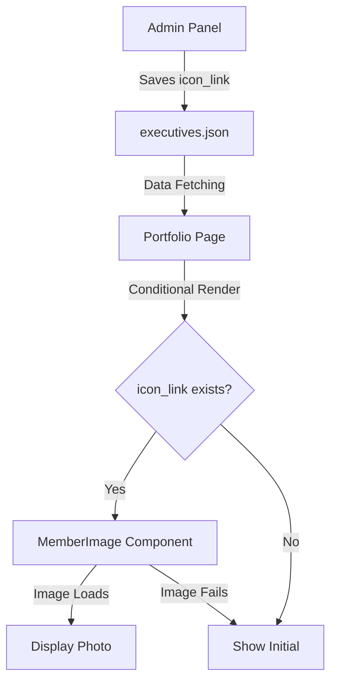

# Icon Link Feature Guide

## Overview

The Icon Link feature allows you to display member photos on their individual portfolio pages instead of showing just their initials. This feature is completely optional - members without photos will continue to show their initials as before.

## How It Works

### Data Structure

The `Member` interface now includes an optional `icon_link` field:

```typescript
export interface Member {
  // ... existing fields
  icon_link?: string;  // Optional URL to member photo
  // ... rest of fields
}
```

### Display Logic

1. **Portfolio Page Only**: Photos only appear on individual portfolio pages (`/profile?id=...`), not in alumni lists or executive lists.
2. **Conditional Rendering**: If `icon_link` exists, the photo is displayed; otherwise, the initial is shown.
3. **Error Handling**: If the image fails to load, the system automatically falls back to showing the initial.
4. **Lazy Loading**: Images are only loaded when the portfolio page is accessed.

## Using the Feature (Admin Guide)

### Adding a Member Photo

1. **Navigate to Admin Panel**: Go to `/admin` and select "Executives Editor"

2. **Select a Member**: Find the member you want to add a photo for and expand their details

3. **Find the Icon Link Field**: Scroll down to find the "Icon Link (Optional - URL to member photo)" field

4. **Enter the Image URL**: Paste the full URL to the member's photo (e.g., `https://example.com/photo.jpg`)

5. **Save Changes**: Click the save button to update the data

### Best Practices

- **Image Format**: Use JPG or PNG format for best results
- **Image Size**: Recommended size is at least 200x200 pixels for good quality
- **Image Aspect**: Square or circular images work best (will be cropped to circle)
- **Image Hosting**: Use reliable image hosting (Wikipedia, Imgur, GitHub, etc.)
- **URL Format**: Always use full URLs starting with `https://`

### Example URLs

```
# Wikipedia (recommended for public figures)
https://upload.wikimedia.org/wikipedia/commons/9/99/Elon_Musk_Colorado_2022_%28cropped2%29.jpg

# Imgur
https://i.imgur.com/abc1234.jpg

# GitHub
https://github.com/username.png
```

## Technical Details

### Image Component

The feature uses a dedicated client component (`src/app/profile/MemberImage.tsx`) that:
- Handles image loading and error states
- Manages the fallback to initials
- Uses standard HTML `img` or custom error boundary logic to handle fallback gracefully

### CSS Styling

```css
.memberPhoto {
  width: 120px;
  height: 120px;
  border-radius: 50%;
  object-fit: cover;
}
```

### Data Flow



## Troubleshooting

### Image Not Showing

1. **Check the URL**: Verify the URL is correct and accessible
2. **Check the Format**: Ensure it's a valid image URL (ends with .jpg, .png, etc.)
3. **Check CORS**: Some sites may block hotlinking (try a different host)
4. **Check Console**: Look for error messages in browser console

### Fallback Not Working

1. **Clear Cache**: Try clearing browser cache
2. **Check Data**: Verify the member data was saved correctly
3. **Test with Valid URL**: Try a known-working image URL

## Backward Compatibility

- The `icon_link` field is completely optional
- Existing members without photos continue to work normally
- No changes required to existing data
- Graceful degradation if anything fails

## Future Enhancements

Possible improvements for future versions:
- Image upload functionality (instead of URL input)
- Image validation in admin panel
- Multiple image support (gallery)
- Image cropping tool
- Local image storage

## Support

If you encounter any issues with this feature:
1. Check this documentation
2. Review the implementation in the codebase
3. Test with the sample data (Elon Musk profile)
4. Contact the maintainers if issues persist
